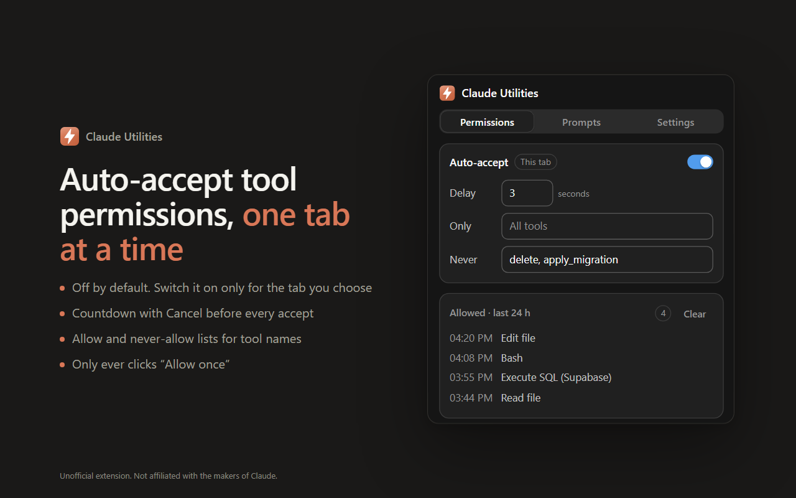
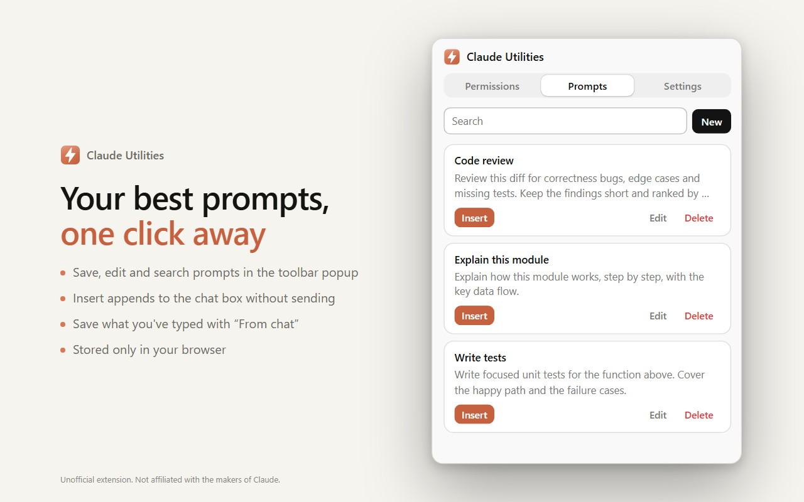

<p align="center">
  
</p>

<h1 align="center">Claude Utilities</h1>

<p align="center">
  Unofficial browser extension with small, focused tools for <a href="https://claude.ai">claude.ai</a> and Claude Code on the web.
</p>

<p align="center">
  
</p>

> **Unofficial.** Claude Utilities is an independent project. It is not affiliated with, endorsed by, or sponsored by the makers of Claude. "Claude" is a trademark of its owner.

## Features

### Auto-accept tool permissions (per tab)

When Claude asks *"Allow Claude to use &lt;tool&gt;?"*, the extension can click **Allow once** for you.

- **Off by default, per tab.** Switch it on from the popup for the tab you are in; every other tab stays manual. The switch is forgotten when the tab closes or the browser restarts. The toolbar badge shows **ON** on tabs where it is active.
- **Countdown with Cancel.** Waits a configurable delay (default 3 s, 0 for immediate) and shows a small banner on the page so you can cancel.
- **Allow and never-allow lists.** Limit it to certain tools, or keep risky ones (for example `delete, apply_migration`) for you to approve.
- **Only "Allow once".** It never clicks Deny or any "always allow" option.
- **Long inputs.** When Claude keeps "Allow once" disabled until you scroll to the end of a long tool input, it scrolls the input box first.
- **Activity.** The last 24 hours of auto-accepted tools are listed in the popup and then deleted automatically.

### Saved prompts



- Save, edit, search and delete prompts in the popup.
- **Insert** appends a prompt to the chat box of the current claude.ai tab (as a new paragraph, without sending).
- **From chat** fills a new prompt with what you have already typed.

### Settings

- **Export data** downloads one JSON file with your settings, saved prompts and activity log.

The popup follows claude.ai's look (colours, type, buttons and toggles) in light and dark mode.

## Install

**Chrome Web Store:** coming soon.

**From source (Chrome, Edge, Brave or other Chromium browsers):**

1. Download or clone this repository.
2. Open `chrome://extensions` (`brave://extensions`, `edge://extensions`) and turn on **Developer mode**.
3. Click **Load unpacked** and select the repository folder.
4. Open a claude.ai tab and click the extension icon.

## Permissions

| Permission | Why it is needed |
|---|---|
| `https://claude.ai/*` (host) | Runs the auto-accept script on claude.ai and lets the popup see whether the current tab is claude.ai. |
| `scripting` | Inserts a saved prompt into, or reads the text of, the chat box of the current claude.ai tab when you click **Insert** or **From chat**. |
| `storage` | Saves your settings, prompts, per-tab switches and the 24-hour activity log in your browser. |
| `alarms` | Runs an hourly cleanup that deletes activity entries older than 24 hours. |

## Privacy

Everything stays in your browser. The extension has no server, collects no analytics, and sends nothing anywhere. See [PRIVACY.md](PRIVACY.md).

## Development

No build step: the extension is plain JavaScript loaded directly from `src/`. Node.js 18+ is only needed for the helper scripts.

```sh
npm run check     # syntax-check all scripts, compare manifest/package versions
npm run images    # re-render icons and store images from store/src (needs Chrome, Edge or Brave)
npm run package   # validate manifest.json and build dist/claude-utilities-<version>.zip
```

After changing code, press reload on the extension card and refresh open claude.ai tabs.

### Layout

```
manifest.json
icons/                         toolbar and store icons (generated by npm run images)
src/background.js              badge, per-tab state, activity log storage and cleanup
src/core/registry.js           ClaudeUtilities.register() / registerSection()
src/core/storage.js            settings (sync) and per-tab switches (session)
src/core/log.js                ClaudeUtilities.log(utilityId, message)
src/core/prompts.js            saved prompts (local)
src/content/runner.js          starts, updates and stops page utilities
src/utilities/*.js             one file per page utility
src/popup/                     tabbed popup built from the registry
src/popup/sections/*.js        popup-only tabs (Prompts, Settings)
store/src/                     HTML sources for the icon and store images
store/images/                  generated store images
scripts/                       check, image and packaging scripts
docs/                          Chrome Web Store listing and publishing guide
```

### Adding a utility

- **Page utility** (runs on claude.ai): create `src/utilities/my-utility.js` calling `ClaudeUtilities.register({...})` (the shape is documented in `src/core/registry.js`). Add it to `content_scripts.js` in `manifest.json` before `runner.js`, and add a `<script>` tag in `src/popup/popup.html`. It gets its own popup tab with a toggle, options and activity. Use `scope: "tab"` to make it opt-in per tab.
- **Popup-only tab:** create `src/popup/sections/my-section.js` calling `ClaudeUtilities.registerSection({ id, label, order, render(panel, { tab }) })` and add a `<script>` tag in `src/popup/popup.html`.

## Publishing

See [docs/CHROME_WEB_STORE.md](docs/CHROME_WEB_STORE.md) for the store listing text, permission justifications, privacy answers, image list and submission steps.

## License

[MIT](LICENSE)
